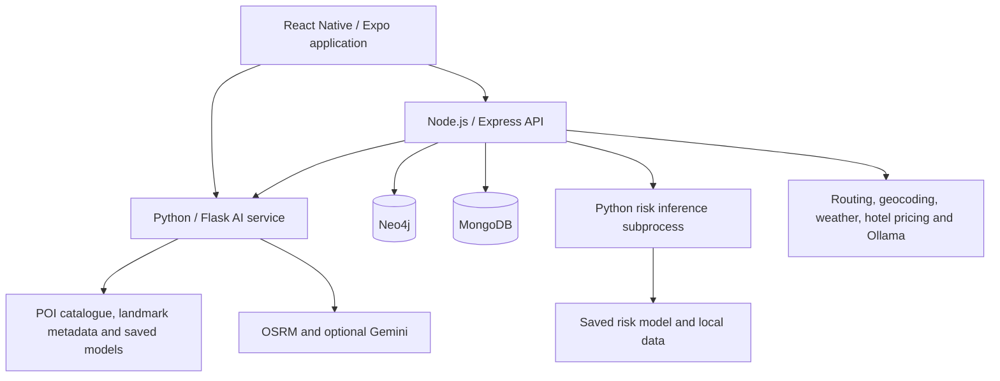

# CeylonGo

## AI-Powered Unified Sri Lankan Tourism Platform Using GraphRAG and LLM Orchestration

**Research group:** R26-IT-050  
**Institution:** Sri Lanka Institute of Information Technology (SLIIT)  
**Programme:** BSc (Hons) in Information Technology, Specializing in Information Technology

CeylonGo is a Sri Lankan tourism decision-support research prototype. It connects hotel and activity recommendations, personalised itineraries, route-risk and vehicle advice, and landmark recognition in one React Native/Expo application.

This repository contains the **research product and research artifacts**. A separate academic information website can describe its methodology, findings, documents, and team; that website is not the application documented here.

> **Status:** Implementation and stored component evaluations are available. Production deployment, comprehensive field validation, and overall platform accuracy are not established. Setup commands below are instructions for developers, not a record that they have been executed successfully on every platform.

## Table of contents

- [Project overview](#project-overview)
- [Research components](#research-components)
- [Technology stack](#technology-stack)
- [Architecture](#architecture)
- [Folder structure](#folder-structure)
- [Folder explanations](#folder-explanations)
- [How a request flows](#how-a-request-flows)
- [Getting started](#getting-started)
- [Local setup](#local-setup)
- [Environment variables](#environment-variables)
- [API endpoints](#api-endpoints)
- [Request examples](#request-examples)
- [Datasets and model artifacts](#datasets-and-model-artifacts)
- [Testing and evaluation](#testing-and-evaluation)
- [Known limitations](#known-limitations)
- [Troubleshooting](#troubleshooting)
- [Research documentation](#research-documentation)
- [Team and supervision](#team-and-supervision)
- [Development notes](#development-notes)
- [References and licensing](#references-and-licensing)

## Project overview

Travellers often need to combine accommodation, activities, travel times, transport suitability, and attraction information from separate sources. CeylonGo investigates how these decisions can be connected while preserving preferences and making missing evidence visible.

The main objective is to develop and examine a unified tourism decision-support prototype. Specific objectives are to expose four capabilities through shared interfaces, preserve traveller constraints, explain recommendations using available evidence, evaluate individual components, and identify requirements for further deployment.

The intended users are people planning visits within Sri Lanka. Tourism operators are a potential secondary audience. Booking, payments, emergency response, guaranteed safe travel, and proven economic or environmental benefits are outside the demonstrated scope.

## Research components

| Component | Responsibility | Implemented approach | Main outputs |
| --- | --- | --- | --- |
| C1 — Intelligent Tour Package Generation | Deniyawatte D.G.A.D.N. · IT22895196 | Natural-language preference extraction, Neo4j retrieval, deterministic package composition, selected-hotel pricing | Hotel/activity suggestions, basic day plans, room-offer status |
| C2 — Context-Aware Itinerary Optimizer | Kumarasinghe K.G.A.M.S.D.C. · IT22224866 | Frozen relevance classifier, proximity/semantic ranking, seeded genetic algorithm, road-time scheduling | Ordered stops, schedule, map data, explanations, regenerated plans |
| C3 — Intelligent Mobility, Route-Risk & Vehicle Selection | Wijesinghe I.D.W. · IT22555458 | Route retrieval, historical evidence, Gradient Boosting severity classification, constraint-based vehicle selection | Analyzed route, comparison status, severity class, vehicle shortlist, cost estimate |
| C4 — AI Landmark Recognition & Tourist Information | Madushan M. · IT22214720 | MobileNetV2 features with SVM, TFLite fallback, CSV metadata retrieval, optional Gemini guide | Landmark prediction, visitor information, contextual conversation |

### C1: Tour packages

- Accepts a travel prompt and optional stay information.
- Uses Ollama for structured preference extraction, with a deterministic schema-aware fallback.
- Retrieves graph-backed hotels and activities and returns up to three hotel-centred recommendations.
- Builds day plans in the controller using deterministic rules. The separate LLM itinerary-text helper is not the active composition path.
- Retrieves a hotel offer separately after selection; an unavailable offer is not replaced with a fabricated price.
- Passes a selected hotel into the mobility flow.

### C2: Itinerary optimisation

- Uses a bounded catalogue of 40 Central Province POIs: 20 Kandy, 10 Matale, and 10 Nuwara Eliya.
- Applies the frozen v1 relevance model, with an explicit content-based fallback, before 70% proximity / 30% semantic ranking.
- Limits a plan to 15 candidates and eight selected stops. A seeded genetic algorithm selects stops; final ordering and scheduling use road-time constraints.
- Supports departure time, breaks, travel buffers, optional return, supplied opening windows, regeneration, replacement, and rescheduling.
- Provides field-evidence entry and export tools. Their presence does not establish completed field trials.

### C3: Mobility and vehicles

- Resolves locations, obtains OSRM routes, and aggregates matching road-family records.
- Classifies historical hazard severity as Low, Medium, or High. This is not accident probability.
- Recommends a lower-risk alternative only when distinct usable evidence supports comparison; otherwise returns the default analyzed route with an explicit comparison status.
- Filters vehicles by constraints and ranks them using available road-capability attributes.
- Estimates cost as `BaseHireCharge + DistanceKM × RentalPricePerKM`.
- Supports dataset baseline rates and MongoDB-backed administrator overrides with source/date fields. Administrative verification is not independent market validation.

### C4: Landmarks and guide

- Accepts image uploads for 17 supported landmark classes.
- Uses an SVM with MobileNetV2 features when available, otherwise the TFLite path.
- Maps predictions to CSV metadata and offers an Ayubowan AI chat interface.
- Uses Gemini when configured and local rule-based responses when unavailable.
- Runs inference on the Python server; on-device inference is not demonstrated.

## Technology stack

| Layer | Technologies | Actual role |
| --- | --- | --- |
| Application | React 19, React Native 0.81, Expo SDK 54 in the frontend manifest | Shared mobile/web UI |
| Navigation | React Navigation | Active navigation in `frontend/App.js` |
| Maps and device features | React Native Maps, Leaflet/React Leaflet, Expo Location, Expo Image Picker | Route maps, location selection, image acquisition |
| JavaScript backend | Node.js, Express 5, Axios | APIs, validation, orchestration, external requests |
| Python service | Python 3.11/3.12, Flask, Flask-CORS, requests | Itinerary and landmark endpoints |
| Graph storage | Neo4j, Cypher, neo4j-driver | Hotel/activity relationships and historical safety evidence |
| Document storage | MongoDB, Mongoose | Itinerary persistence, administrator records, pricing overrides |
| ML/data processing | scikit-learn 1.7.2, pandas, NumPy, SciPy, joblib | Classifiers, preprocessing, evaluation, saved artifacts |
| Vision | TensorFlow/Keras, TensorFlow Lite, Pillow | Landmark experiments and inference |
| Language services | Ollama, optional Gemini | Preference extraction, optional location candidates, contextual explanations/guide |
| Routing/geocoding | OSRM, OpenStreetMap, Nominatim, optional Geoapify | Road geometry, travel estimates, place resolution |
| Other providers | OpenWeather, LiteAPI/Nuitee | Weather context and hotel offers |
| Development/research | npm, Node test runner, Supertest, Python unittest, ESLint, TypeScript configuration, Jupyter/Colab | Development, verification, stored experiments |

Expo Router files and dependencies also exist, but the frontend manifest uses `expo/AppEntry` and the active application is `App.js`. The root dependency manifest differs from the frontend manifest; use the service-specific manifests for setup. No production hosting configuration is established by this README.

## Architecture



Default local service addresses:

| Service | Address |
| --- | --- |
| Express | `http://localhost:5001` |
| Express API prefix | `http://localhost:5001/api` |
| Flask AI service | `http://localhost:5002` |
| Neo4j Bolt | `bolt://localhost:7687` |
| Ollama package-extraction service | `http://127.0.0.1:11434` |

Graph retrieval, ML classification, deterministic rules, optimisation, and generated language have separate roles. The research title does not mean that every component performs GraphRAG. Landmark retrieval, for example, uses class mapping and CSV matching.

## Folder structure

The tree is abbreviated; dependency directories, virtual environments, and repeated document-render artifacts are omitted.

```text
R26-IT-050/
├── README.md
├── package.json                  # Root dependency manifest; no unified start script
├── backend/
│   ├── package.json
│   ├── requirements.txt
│   ├── .env.example
│   ├── README.md
│   ├── SAFETY_ANALYZER_TECHNICAL_NOTES.md
│   ├── tests/
│   └── src/
│       ├── app.js                # Active Express entry point
│       ├── server.js             # Additional file; npm start uses app.js
│       ├── config/
│       ├── routes/
│       ├── controllers/
│       ├── services/
│       │   └── llm/
│       ├── models/
│       ├── data/
│       ├── scripts/
│       ├── utils/
│       ├── ai-engine/
│       │   ├── data/
│       │   ├── scripts/
│       │   └── knowledge-graph/
│       └── ai_service/
│           ├── app.py
│           ├── model.py
│           ├── road_routing.py
│           ├── landmark_routes.py
│           ├── models/
│           ├── data/
│           │   ├── raw/
│           │   ├── staging/
│           │   ├── verified/
│           │   └── evaluation/
│           ├── scripts/
│           └── tests/
├── frontend/
│   ├── App.js                    # Active app and navigation
│   ├── app.json
│   ├── package.json
│   ├── .env.example
│   ├── src/
│   │   ├── api/
│   │   ├── components/
│   │   ├── screens/
│   │   └── styles/
│   ├── screens/                  # Itinerary and landmark screens used by App.js
│   ├── services/
│   ├── components/
│   ├── assets/
│   ├── app/                      # Expo Router scaffold/alternate routes
│   └── tests/
├── data-scripts/
│   ├── data_collection.py
│   └── Landmark_Recognition.ipynb
├── docs/
├── output/
│   └── reports/
└── tmp/                          # Report assembly and rendering artifacts
```

## Folder explanations

| Folder | Purpose |
| --- | --- |
| `backend/src/routes` | Mountable Express endpoint definitions |
| `backend/src/controllers` | Request validation, orchestration, response construction |
| `backend/src/services` | Routing, weather, graph queries, pricing, safety, authentication, AI-service forwarding |
| `backend/src/services/llm` | Preference prompts, Ollama calls, validation, and a separate itinerary-text helper |
| `backend/src/config` | Neo4j driver configuration; legacy config imports share the same driver |
| `backend/src/models` | Mongoose models for itineraries, administrators, and vehicle pricing |
| `backend/src/data` | Hotel and activity CSV inputs |
| `backend/src/ai-engine` | Mobility data preparation, risk-model training/inference, and historical graph logic |
| `backend/src/ai_service` | Flask service, itinerary engine, road scheduling, landmark inference and guide |
| `backend/src/ai_service/data` | Archived prototype data, candidate staging, source-traced catalogues, evaluation evidence |
| `backend/src/ai_service/models` | Frozen relevance and landmark artifacts; candidate files are not automatically active |
| `frontend/src` | Shared application UI, safety, hotels, admin, API clients, styling |
| `frontend/screens`, `services`, `components` | Additional active itinerary/landmark features and helpers; inspect App.js imports to identify active screens |
| `data-scripts` | Collection code and landmark experiment notebook |
| `docs` | Supplementary implementation and field-evaluation guidance |
| `output/reports` | Research theses, integrated report, and outstanding-details lists |
| `tmp` | Document-build intermediates and PDF render passes; not runtime dependencies |

## How a request flows

### Hotel and activity recommendation

1. The user submits a prompt through the hotel interface.
2. Express receives `POST /api/generate-package`.
3. The extraction service retrieves allowed graph values, asks Ollama for preferences, and validates the result. A deterministic fallback handles extraction failure.
4. Parameterised Cypher retrieves matching hotels and activities.
5. The controller ranks a bounded candidate set and constructs day plans.
6. After hotel selection, `POST /api/hotel-price` validates the stay and requests a provider offer.
7. Hotel selection can be handed to the route/vehicle screen. An offer is not a confirmed booking.

### Personalised itinerary

1. The frontend sends preferences and planning constraints to `POST /api/itinerary/optimize`.
2. Express validates and forwards the payload to Flask at `/api/optimize-itinerary`.
3. Flask filters the catalogue, applies relevance/ranking, and selects a stop set.
4. In road mode, OSRM matrix estimates support ordering and schedule feasibility; geometry supports map display.
5. The result contains selected places, timing, explanations, and planning metadata.
6. Express attempts MongoDB persistence when connected. Otherwise the result reports skipped persistence; a failed save is reported separately.
7. The frontend can regenerate, replace a stop, reschedule, or request itinerary vehicle advice.

### Route and vehicle recommendation

1. The frontend sends locations and transport preferences to `POST /api/safety/recommend-route`.
2. Location resolution and OSRM supply the route and alternatives.
3. The backend matches available route-family road evidence and retrieves historical Neo4j context.
4. A bounded Python subprocess loads the risk artifact and predicts severity.
5. Alternatives are compared only when their evidence supports distinct evaluation.
6. Backend-derived road context drives vehicle filtering and ranking. Pricing uses baseline values or available administrative overrides.
7. The UI displays route status, vehicle estimates, explanation details, and unavailable evidence explicitly.

### Landmark recognition and guide

1. The frontend sends multipart image data directly to Flask `/api/landmark/predict`.
2. The server decodes/resizes the image and runs the selected available inference path.
3. The predicted class is mapped to local CSV metadata.
4. `/api/landmark/chat` combines the landmark context, question, and supplied history.
5. Gemini or the local fallback produces the reply. Recognition confidence does not measure answer factuality.

## Getting started

### Prerequisites

- Node.js and npm compatible with the Express/Expo dependencies. The repository does not pin a Node version.
- Python **3.11 or 3.12**. Python 3.14 is not supported by the documented landmark setup.
- Neo4j for package retrieval and historical graph evidence.
- MongoDB for saved itineraries and administrator pricing; core itinerary results can return without persistence.
- Internet access for external routing/geocoding and configured providers.
- Optional Ollama for language-assisted extraction and optional Gemini credentials for the guide.
- A browser for web development, or a compatible Expo/device environment for mobile development.

Start with separate `backend` and `frontend` installations. The root package has no command that starts the whole project.

## Local setup

Commands assume a terminal opened at the repository root. They install dependencies or start services only when you choose to execute them.

### 1. Install the backend dependencies

```bash
cd backend
npm ci
python3.11 -m venv .venv311
source .venv311/bin/activate
python -m pip install -r requirements.txt
```

Python 3.12 can also create the environment. Keeping the directory name `.venv311` preserves the current macOS/Linux launcher default; otherwise configure `PYTHON_BIN` explicitly. scikit-learn is pinned to match the saved model artifacts.

On Windows PowerShell, use the equivalent virtual-environment commands:

```powershell
cd backend
py -3.11 -m venv .venv311
.\.venv311\Scripts\Activate.ps1
python -m pip install -r requirements.txt
```

### 2. Configure services and environment

If a local configuration does not already exist, copy `backend/.env.example` to `backend/.env`, then fill in your own values. Do not overwrite an existing `.env`. Configure Neo4j credentials and, if needed, MongoDB and provider access.

Set administrator credentials and a strong token secret before enabling MongoDB-backed admin access. The implementation contains development fallbacks; they are not suitable for a shared deployment. Backend startup can seed an administrator when MongoDB is connected.

Graph-dependent features need populated Neo4j data. Graph-build endpoints write to the database and should only be used deliberately against a development graph. **Current blocker:** activity ingestion expects `backend/src/data/activities_2000_graph_rag.csv`, while the repository contains `backend/src/data/Activities-Rag.csv`. Resolve and verify that source mapping before attempting a fresh activity-graph build. This README does not claim that a full clean rebuild currently succeeds.

### 3. Start Express — terminal A

From `backend/`:

```bash
npm start
```

For Node's watch mode, use `npm run dev`. The default port is 5001.

### 4. Start the Python AI service — terminal B

From `backend/` on macOS/Linux:

```bash
npm run ai-service
```

This npm script uses POSIX shell syntax and defaults to `.venv311/bin/python`. On Windows, launch directly:

```powershell
.\.venv311\Scripts\python.exe src\ai_service\app.py
```

Also set `PYTHON_BIN` in the backend environment to the Windows virtual-environment interpreter for Node's separate risk-inference subprocess. Flask defaults to port 5002. Changing that port also requires updating the Node and frontend AI-service URLs.

Landmark startup requires the bundled model files and compatible TensorFlow. The SVM feature extractor may download ImageNet weights on first use. TFLite is loaded before the optional SVM path; disabling SVM does not eliminate the TFLite dependency.

### 5. Install and start the frontend — terminal C

From the repository root:

```bash
cd frontend
npm ci
npm run web
```

Other existing scripts:

```bash
npm start
npm run android
npm run ios
```

Follow Expo's displayed development URL/device instructions. Use `frontend/.env` for URL overrides listed below. Restart Expo after changing environment variables.

On a physical phone, `localhost` refers to the phone. Set the public API URLs to your development machine's reachable LAN address and ensure both service ports are accessible. The API client also attempts to derive the development host from Expo/browser context.

### 6. Optional language services

If Ollama is already installed, run its server and provide the configured package-extraction model. Package extraction defaults to `llama3`; the separately implemented optional location resolver explicitly uses `llama3.1:8b`. The package `OLLAMA_MODEL` setting does not change that location resolver.

The location resolver is opt-in through `ENABLE_OLLAMA_LOCATION_RESOLVER`. Gemini is optional; local guide responses remain available without it. Model availability depends on your provider configuration.

### 7. Check service availability

```bash
curl http://localhost:5001/
curl http://localhost:5002/api/landmark/health
```

The Express health response confirms HTTP availability, not complete database/provider readiness. The landmark health endpoint exists only if its blueprint loaded successfully. These checks are not research evaluation results.

## Environment variables

Do not commit `.env` files, API keys, database connection strings, or administrator secrets. The tables list names and roles, not real credentials. Backend values belong in `backend/.env`; frontend overrides belong in `frontend/.env`.

### Backend infrastructure and models

| Variable | Role / local behaviour |
| --- | --- |
| `PORT` | Express port; default 5001 |
| `PYTHON_AI_URL` | Flask base URL used by Express; default `http://127.0.0.1:5002` |
| `AI_SERVICE_PORT` | Flask port; default 5002 |
| `PYTHON_BIN` | Python interpreter for risk inference; also read by the POSIX npm AI launcher from its shell environment |
| `FLASK_DEBUG` | Optional Flask development debug mode |
| `MONGO_URI` | MongoDB connection; enables persistence and admin features |
| `NEO4J_URI` | Neo4j Bolt connection; local default `bolt://localhost:7687` |
| `NEO4J_USERNAME` | Neo4j username |
| `NEO4J_PASSWORD` | Neo4j password |
| `ADMIN_EMAIL` | Administrator account used during startup seeding |
| `ADMIN_PASSWORD` | Administrator seed password; supply your own |
| `ADMIN_TOKEN_SECRET` | Administrator token signing secret; supply your own |
| `LANDMARK_ENABLE_SVM` | Enables optional SVM path; defaults to true |
| `ITINERARY_RELEVANCE_MODEL_PATH` | Optional relevance-artifact path override; default is the frozen v1 artifact |
| `ML_PREDICTION_TIMEOUT_MS` | Timeout used by the shared safety-analysis inference service; default 15000 ms |

The npm launcher evaluates `PYTHON_BIN` before Python loads `.env`. For a non-default interpreter, export it in the terminal before `npm run ai-service`, or invoke that interpreter directly. Node's risk service reads the backend environment after dotenv loading.

### Provider configuration

| Variable | Role |
| --- | --- |
| `OPENWEATHER_API_KEY` | Weather enrichment; weather is context rather than a deployed risk-model feature |
| `GEOAPIFY_API_KEY` | Optional geocoding/typo-candidate fallback |
| `ROUTING_REQUEST_TIMEOUT_MS` | Mobility routing request timeout; default 10000 ms |
| `ITINERARY_OSRM_URL` | Itinerary road server; default `https://routing.openstreetmap.de/routed-car` |
| `OLLAMA_BASE_URL` | Package extraction endpoint; default `http://127.0.0.1:11434` |
| `OLLAMA_MODEL` | Package extraction model; default `llama3` |
| `OLLAMA_TIMEOUT_MS` | Package extraction timeout; default 30000 ms |
| `ENABLE_OLLAMA_LOCATION_RESOLVER` | Opt-in location candidate generation; default false |
| `GEMINI_API_KEY` | Optional guide/language-provider credential |
| `GEMINI_MODEL` | Optional Gemini model selection; choose a model available to your account |
| `LITEAPI_KEY` | Hotel-rate provider credential |
| `LITEAPI_BASE_URL` | Hotel provider base URL; default `https://api.liteapi.travel/v3.0` |
| `LITEAPI_CURRENCY` | Hotel quote currency; default USD unless overridden by request |
| `LITEAPI_GUEST_NATIONALITY` | Hotel quote nationality parameter; default LK |

Mobility routing separately uses `router.project-osrm.org`; `ITINERARY_OSRM_URL` does not reconfigure every routing call. Provider sandbox offers must remain labelled as sandbox, not production-market prices.

### Frontend public configuration

| Variable | Local example |
| --- | --- |
| `EXPO_PUBLIC_API_BASE_URL` | `http://localhost:5001/api` |
| `EXPO_PUBLIC_ITINERARY_API_BASE_URL` | `http://localhost:5001/api/itinerary` |
| `EXPO_PUBLIC_AI_SERVICE_BASE_URL` | `http://localhost:5002` |

`EXPO_PUBLIC_*` values are exposed to the client bundle. Put only public service addresses here, never private provider keys. Some supported settings above are not listed in the current example files.

## API endpoints

JSON is used unless specified otherwise. These are mounted routes from the active Express/Flask entry points, not every experimental helper file in the repository.

### Express — default port 5001

| Method | Path | Purpose / input |
| --- | --- | --- |
| GET | `/` | Basic backend health response |
| POST | `/api/generate-package` | `prompt`, optional `stay`; returns hotel/activity recommendations |
| POST | `/api/hotel-price` | `hotelId`, `stay`, optional uppercase currency code; returns selected-hotel offer status |
| POST | `/api/build-graph` | Imports the hotel CSV into Neo4j; database mutation |
| POST | `/api/build-activity-graph` | Imports activity data into Neo4j; database mutation; current filename mismatch |
| POST | `/api/itinerary/optimize` | Preferences and planning constraints; forwards to Flask and optionally persists the result |
| POST | `/api/safety/recommend-route` | Locations and optional vehicle constraints; route comparison and vehicle advice |
| POST | `/api/safety/recommend-itinerary` | Starting location, ordered optimized stops, and transport preferences; itinerary safety/vehicle integration |
| POST | `/api/safety/recommend-vehicle` | Existing vehicle recommendation contract using start/end locations, budget, passengers, category |
| POST | `/api/admin/login` | Administrator email/password; requires MongoDB |
| GET | `/api/admin/vehicle-pricing` | Dataset rates plus saved overrides; admin bearer token required |
| PUT | `/api/admin/vehicle-pricing/:vehicleName` | Update named vehicle rates, source, effective date, and active flag; admin bearer token required |

### Flask — default port 5002

| Method | Path | Purpose / input |
| --- | --- | --- |
| POST | `/api/optimize-itinerary` | Direct itinerary optimisation; normally called through Express |
| POST | `/api/landmark/predict` | Multipart `image`; optional `?mode=svm` or `?mode=tflite` |
| POST | `/api/landmark/chat` | JSON `message`, optional `landmark_name` and `history` |
| GET | `/api/landmark/list` | Metadata for supported model labels |
| GET | `/api/landmark/health` | Landmark service/model availability metadata |

The landmark prediction route rejects request bodies larger than 10 MB and invalid images. Its confidence threshold is an implementation rule, not a validated open-world rejection guarantee.

Error contracts vary by endpoint. Examples include validation errors, HTTP 409 for infeasible/exhausted itinerary alternatives, controlled upstream failures, and `ML_UNAVAILABLE` on the legacy vehicle route when inference fails. Inspect the relevant controller for exact response fields; do not assume all endpoints share one error schema.

## Request examples

These are input examples, not measured research outcomes. They require the relevant services/data and may produce unavailable or no-match responses.

### Route and vehicle

```bash
curl -X POST http://localhost:5001/api/safety/recommend-route \
  -H 'Content-Type: application/json' \
  -d '{"startLocation":"Kandy","endLocation":"Colombo","budget":25000,"passengers":4,"preferredCategory":"Sedan"}'
```

### Hotel-centred package

```bash
curl -X POST http://localhost:5001/api/generate-package \
  -H 'Content-Type: application/json' \
  -d '{"prompt":"Plan a three day nature trip in Kandy"}'
```

For `/api/hotel-price`, use a hotel ID returned by the graph and a `stay` containing `checkInDate`, `checkOutDate`, `adults`, and `roomQuantity`. Use valid dates for the intended stay, not an arbitrary example ID or assumed offer.

### Road-based itinerary

Send this JSON to `POST /api/itinerary/optimize`; replace the departure timestamp with your intended date/time:

```json
{
  "preferences": ["Nature", "Culture"],
  "current_lat": 7.2906,
  "current_lon": 80.6337,
  "max_time_minutes": 480,
  "radius_km": 15,
  "routing_mode": "road",
  "departure_time": "2026-11-01T08:00:00+05:30",
  "return_to_start": true,
  "break_minutes": 30,
  "travel_buffer_percent": 25,
  "visit_windows": {}
}
```

The timestamp is illustrative, not an assessment date. Legacy API callers omitting road mode retain the older calculation; the current planner UI requests road mode. Road-routing failure does not silently substitute straight-line travel estimates.

### Landmark image and chat

```bash
curl -X POST http://localhost:5002/api/landmark/predict \
  -F 'image=@/absolute/path/to/landmark.jpg'

curl -X POST http://localhost:5002/api/landmark/chat \
  -H 'Content-Type: application/json' \
  -d '{"message":"What should I know before visiting?","landmark_name":"Sigiriya","history":[]}'
```

## Datasets and model artifacts

| Area | Main files | Scope |
| --- | --- | --- |
| Hotels | `backend/src/data/SLTDA_Master_Dataset_Updated_Coords.csv` | 1,830 local rows; a filename is not proof of official provenance |
| Activities | `backend/src/data/Activities-Rag.csv` | 2,000 local rows; ingestion currently references another filename |
| Mobility | `backend/src/ai-engine/data/` | Primary road/disaster/vehicle inputs, processed CSVs, 598-row training set, stored model comparisons |
| Active risk model | `backend/src/ai-engine/scripts/risk_model_v2.joblib` | Selected Gradient Boosting classifier |
| Legacy risk model | `backend/src/ai-engine/scripts/safety_model.joblib` | Older experiment; not the current v2 inference artifact |
| Runtime POIs | `backend/src/ai_service/data/verified/central_province_runtime_verified_v1.csv` | 40 source-traced POIs |
| Archived POIs | `backend/src/ai_service/data/places.csv`, `data/raw/places_synthetic_prototype_v1.csv` under the same service | 1,000-row synthetic/prototype dataset; not current runtime evidence |
| Active relevance | `backend/src/ai_service/models/user_poi_relevance_v1.joblib` | Frozen Linear SVM; candidate v2 files are separate |
| Landmark artifacts | `backend/src/ai_service/models/` | Labels, scaler, SVM, float/quantized TFLite files |
| Landmark metadata | `backend/src/ai_service/data/Sri_Lankan_Landmark.csv` | Information lookup after recognition |

Mobility numeric gaps are imputed in the ML pipeline rather than filled with fabricated road observations. Only 135 of 598 training records have matching road profiles; 463 do not. Source severity labels define the target and have not been independently validated.

Training and collection scripts can overwrite artifacts, produce files, or contact external sources. They are not required simply to start from the existing saved models. Preserve raw data, manifests, licences, splits, and model hashes when conducting new experiments.

## Testing and evaluation

### Existing verification commands

From `backend/`:

```bash
npm test
.venv311/bin/python -B -m unittest discover -s src/ai_service/tests -p 'test_*.py'
```

Use `.venv311\Scripts\python.exe` for the Python command on Windows. From `frontend/`:

```bash
node --test tests/*.test.cjs
npm run lint
```

The suites cover selected API contracts, location matching, provider failures, safety integration, itinerary relevance/regeneration, road scheduling, evidence handling, and pricing. Dependencies and model artifacts are required for relevant Python tests. These commands are documented here; no fresh pass count is asserted.

### Stored research results

| Experiment | Stored result | Evaluation boundary |
| --- | --- | --- |
| Route-severity Gradient Boosting | Accuracy 88.20%; Macro-F1 0.8780 | Reserved unseen-route holdout against internal severity-derived labels |
| Itinerary relevance v1 | Accuracy 68.33%; Macro-F1 0.5196 | 60 human-reviewed pairs across three held-out Kandy profiles |
| Itinerary relevance v2 candidate | Accuracy 60.00%; Macro-F1 0.5775; activation gate failed | Separate 60-label, single-reviewer Matale/Nuwara Eliya extension |
| Landmark custom CNN | Validation accuracy 49.45% | Saved notebook validation partition |
| Landmark fine-tuned MobileNetV2 | Validation accuracy 85.55% | Same notebook partition |
| Landmark native ViT | Validation accuracy 42.55% | Same notebook partition |
| Landmark deep features + SVM | Validation accuracy 93.18%; weighted-F1 93.23% | Same reused 1,100-image validation partition; not verified serving accuracy |

The risk workflow uses route-group development cross-validation and repeated development splits before final holdout evaluation, then refits the selected architecture on the full dataset. Itinerary weak-label validation measures reproduction of rule-derived supervision, not real-user satisfaction. Landmark notebook counts report 4,400 training and 1,100 validation images across 17 classes.

Do not average these results into a platform accuracy. Mock provider responses, UI screenshots, model confidence, and passing software tests are not field outcomes. Real-trip timing, complete platform usability, package relevance, and guide factuality remain unmeasured in the inspected evidence.

## Known limitations

- **Integration:** Individual flows and handoffs exist, but a recorded all-component end-to-end evaluation is missing.
- **Mobility:** Original dataset provenance is incomplete; route-family aggregation is not exact traversed-segment matching. Severity is not accident probability. Weather is contextual, and vehicle ranking is heuristic.
- **Itineraries:** Geography and preference profiles are bounded. Visit durations and the default 25% buffer are assumptions. Supplied opening hours are not verified; no live traffic or closure prediction is provided.
- **Packages:** Activity ingestion has a filename mismatch. Vegetarian substring filtering can also match non-vegetarian values. Candidate limiting precedes ranking, activities can repeat, and district links do not establish travel feasibility.
- **Landmarks:** The notebook SVM uses fine-tuned MobileNetV2 features, while serving reconstructs an ImageNet backbone. TFLite preprocessing may also differ. Serving strings show older accuracy values; they must not be treated as current measured accuracy.
- **Identity:** The ordinary traveller login/register path sets local UI state; it is not evidence of complete persisted traveller authentication. The administrator path is separate.
- **Deployment:** Graph import endpoints mutate data and are not protected by the administrator middleware in the inspected routing. Deployment requires access-control review and removal of development credential fallbacks.
- **Documentation:** Older POI descriptions and report placeholders remain. The itinerary validation document credits IT22555458, whereas the common report assigns C2 to IT22224866; confirm shared contributions with the team.

## Troubleshooting

| Symptom | What to check |
| --- | --- |
| Express starts but packages fail | Neo4j connection, populated Hotel/Activity relationships, activity filename mismatch |
| Itinerary connection failure | Flask is running; `PYTHON_AI_URL` and `AI_SERVICE_PORT` agree |
| Risk inference unavailable | `PYTHON_BIN`, compatible Python packages, and `risk_model_v2.joblib` |
| Landmark endpoints unavailable | Flask startup logs, TensorFlow compatibility, TFLite and label files, blueprint loading |
| First SVM startup is slow | ImageNet feature weights may need downloading; confirm network/cache availability |
| Admin endpoints return 503 | An active MongoDB connection is required |
| Itinerary returns but is not saved | Inspect the response persistence status and MongoDB availability |
| Phone cannot reach APIs | Use the development machine's LAN address; verify ports/firewall and Expo URL overrides |
| No distinct lower-risk alternative | Road evidence may not distinguish alternatives; this is not proof that the displayed route is safest |
| Hotel price unavailable | Credentials, hotel matching, stay details, and provider availability; do not invent a price |
| Road service unavailable | Provider availability and usage limits; the itinerary public server is best-effort infrastructure |
| Changed CSV is not reflected | Mobility road/vehicle CSVs are cached per process; restart after an intentional dataset change |

## Research documentation

- [Backend setup and safety behaviour](backend/README.md)
- [Safety Analyzer technical notes](backend/SAFETY_ANALYZER_TECHNICAL_NOTES.md)
- [Road routing and field-evidence workflow](docs/ishan-route-validation.md)
- [POI dataset documentation](backend/src/ai_service/data/DATASET_README.md) — contains older sections; the current runtime path is defined in `model.py`.
- [Itinerary v1 relevance report](backend/src/ai_service/data/evaluation/user_poi_relevance_model_report_v1.md)
- [Itinerary v2 weak-label comparison](backend/src/ai_service/data/evaluation/user_poi_relevance_v2_weak_cv_report.md)
- [Itinerary v2 single-reviewer evaluation](backend/src/ai_service/data/evaluation/user_poi_relevance_v2_single_reviewer_report_v1.md)
- [Landmark experiment notebook](data-scripts/Landmark_Recognition.ipynb)
- [Common integrated report](output/reports/R26-IT-050_Common_Integrated_Report.docx)
- [Updated mobility thesis](output/reports/IT22555458_Final_Individual_Thesis_Updated.docx)
- [Landmark thesis](output/reports/IT22214720_Final_Individual_Thesis.docx)
- [Package-generation thesis](output/reports/IT22895196_Final_Individual_Thesis.docx)

Older drafts, screenshot versions, and render passes also exist. A `Final` filename does not establish signed approval. Official proposal/PP1/PP2/final/viva dates, marks allocations, charter/TAF, presentation slides, and an IT22224866 individual thesis were not found in the inspected project. Report dates must not be reused as assessment dates.

## Team and supervision

| Name | Student ID | Component |
| --- | --- | --- |
| Deniyawatte D.G.A.D.N. | IT22895196 | C1 — Intelligent Tour Package Generation |
| Kumarasinghe K.G.A.M.S.D.C. | IT22224866 | C2 — Context-Aware Itinerary Optimizer |
| Wijesinghe I.D.W. | IT22555458 | C3 — Intelligent Mobility, Route-Risk & Vehicle Selection |
| Madushan M. | IT22214720 | C4 — AI Landmark Recognition & Tourist Information |

**Supervisor:** Ms. Dilani Lunugalage  
**Co-supervisor:** Ms. Dulani Maheshika Jayasinghe

Names and allocation follow the common integrated report. No private contact details or credentials are included.

## Development notes

- Use the active entry points: `frontend/App.js`, `backend/src/app.js`, and `backend/src/ai_service/app.py`.
- Keep secrets on the backend and preserve sample configuration without real credentials.
- Run checks relevant to changed behaviour; record commands, environment, and results when reporting validation.
- Keep experimental candidates separate from active models. Document a new evaluation and activation decision before replacing an artifact.
- Do not treat training, graph ingestion, collection scripts, or document-generation scripts as read-only commands.
- Preserve source attribution, dataset versions, evaluation splits, and distinctions between measured results and proposals.

## References and licensing

The existing theses cite methodological foundations including Friedman (2001) on gradient boosting; Geisberger et al. (2008) on road routing; Lewis et al. (2020) on retrieval-augmented generation; Sandler et al. (2018) on MobileNetV2; Cortes and Vapnik (1995) on support-vector networks; and Dosovitskiy et al. (2021) on Vision Transformers. See the reports for their full bibliographies.

Relevant provider documentation already referenced by project notes:

- [OSRM API](https://project-osrm.org/docs/v5.24.0/api/)
- [OSRM/FOSSGIS routing service policy](https://routing.openstreetmap.de/about.html)
- [OpenStreetMap attribution and licence](https://www.openstreetmap.org/copyright)

The POI source register documents OpenStreetMap and Wikidata attribution/licensing. Other dataset provenance remains incomplete. The backend package declares ISC metadata, but no repository-wide licence file was found; confirm code, model, and dataset redistribution rights separately before publication. Academic novelty and public reuse rights must not be inferred from file availability.
